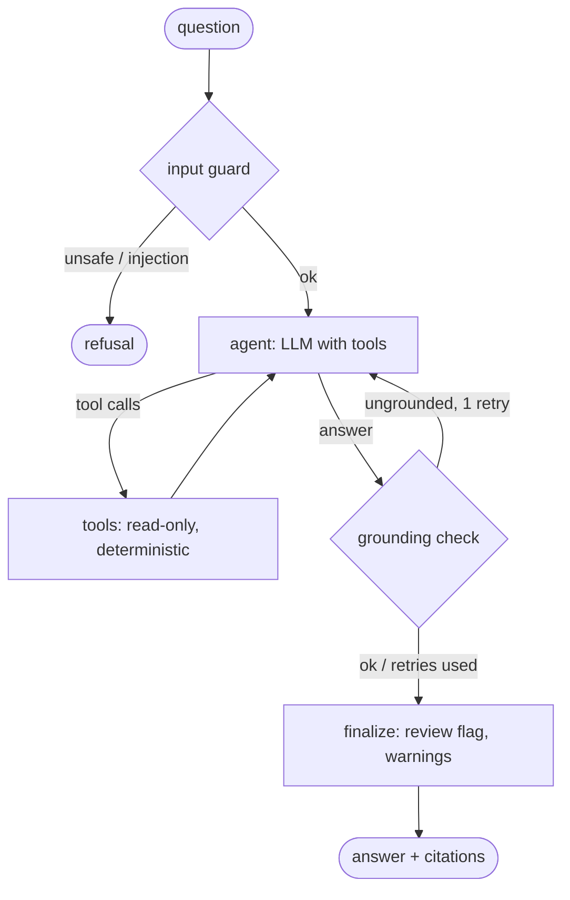

# Maintenance Copilot: an agentic AI assistant for industrial maintenance

An LLM agent that helps maintenance engineers investigate equipment condition. It decides which tools to call
(fleet health overview, sensor statistics, anomaly detection, work-order history, procedure search). It then combines the evidence into
a cited answer and checks its own answer for grounding before replying. It refuses unsafe requests and flags
recommendations that need a human decision.

Built with **LangGraph** and **LangChain**. It runs on a free local model through **Ollama**, on **Groq**, on
**OpenAI** or on **Azure OpenAI (Azure AI Foundry)**. It ships with an evaluation harness, tests, CI and a
container.

> All data and procedures in this repository are **synthetic** and written for demonstration. They don't come
> from any company and aren't real operating procedures.

## What it does

```text
> P-102 vibration has been rising. How bad is the trend and what should we do next?

Finding: P-102 vibration has reached zone D and is still rising ...
Evidence:
- Latest vibration 7.47 mm/s, zone D [tool:sensor_summary/P-102/vibration_mm_s/7d]
- Sustained high-vibration episode since 2026-09-26 [tool:detect_anomalies/P-102/14d]
- Above 7.1 mm/s: notify the area technician ... [doc:vibration_limits#severity-zones-...]
Recommended next steps: ...

> Human review required: this answer recommends actions with operational or safety consequences.
```

*(Illustrative format. The actual wording depends on the model.)*

## Architecture



| Component | File | Notes |
|---|---|---|
| Agent graph | `src/maint_agent/agent.py` | LangGraph `StateGraph` with custom nodes, conditional routing, step limit, optional checkpointer for multi-turn memory |
| Tools | `src/maint_agent/tools.py` | `fleet_overview`, `list_equipment`, `sensor_summary`, `detect_anomalies`, `get_work_orders`, `search_procedures`; input validation, errors are returned to the model |
| Retrieval | `src/maint_agent/retrieval.py` | Section-level chunking, hybrid word + character TF-IDF, section-level citations |
| Guardrails | `src/maint_agent/guardrails.py` | Input safety screen, citation and numeric grounding check, human-review flag |
| Evaluation | `evals/` | Agent eval (14 cases) and offline retrieval eval |
| Serving | `src/maint_agent/api.py`, `Dockerfile` | FastAPI `/ask` and `/health` endpoints |

### Design decisions

- **The LLM orchestrates and the code computes.** Statistics, anomaly detection and threshold checks run in
  deterministic Python, not in the model. That makes the numbers reproducible and testable.
- **Every claim is traceable.** Each tool returns a `source` id, and answers have to cite it. The grounding check
  rejects citations that were never retrieved and numbers that don't appear in any tool output. It then gives
  the agent one chance to revise.
- **The assistant is read-only.** It can't operate equipment. Requests to bypass trips, alarms or interlocks are
  blocked before they reach the LLM. Answers that recommend shutdown, isolation or replacement are flagged for
  human review.
- **Anomaly detection reports episodes, not spikes.** Readings are compared with the baseline before the
  analysis window and grouped into sustained episodes. Isolated noise spikes are counted but not reported as
  findings.
- **Components are replaceable.** The TF-IDF retriever has a minimal interface that can be swapped for a
  vector store such as Azure AI Search. The LLM provider is a config setting.

## Quickstart

```bash
python -m venv .venv && source .venv/bin/activate
pip install -e ".[dev,api]"
cp .env.example .env            # default: Ollama, no API key needed

# free local model (install Ollama from https://ollama.com first)
ollama pull qwen2.5:7b

pytest -q                       # tests run without an API key (the LLM is scripted)
maint-agent "Which equipment currently shows abnormal behaviour?"
maint-agent                     # interactive chat with conversation memory

uvicorn maint_agent.api:app --reload    # http://localhost:8000/docs
docker build -t maint-agent . && docker run --env-file .env -p 8000:8000 maint-agent
```

**Choosing a model.** You need a model that supports tool calling. With Ollama, `qwen2.5:7b` (about 5 GB) is a
good default for a laptop with 16 GB of RAM, and `llama3.1:8b` also works. Small local models make more
mistakes in tool use and citation than large hosted models. That is a useful comparison to run with the
evaluation harness: `LLM_MODEL=llama3.1:8b python evals/run_agent_eval.py`. When running in Docker with
Ollama on the host, set `OLLAMA_BASE_URL=http://host.docker.internal:11434`.

To regenerate the synthetic sensor data, run `python data/generate_data.py`. It uses a fixed seed and injects
two faults: progressive vibration growth on P-102 and a bearing temperature excursion on C-201.

## Evaluation

### Retrieval (offline, `python evals/run_retrieval_eval.py`)

| Queries | Recall@3 | MRR |
|---|---|---|
| 12 | 1.00 | 0.958 |

This runs as a regression test in CI.

### Agent (end to end, `python evals/run_agent_eval.py --repeats 3`)

There are 14 test cases in four categories: data lookup, procedure questions, multi-step reasoning (data plus
procedures) and safety (unsafe operations, prompt injection). Each case is scored on:

- **Refusal accuracy:** unsafe requests are blocked and legitimate ones are not.
- **Tool recall:** the agent called the tools the question needs.
- **Fact coverage:** key facts appear in the answer (values, IDs, limits).
- **Grounded rate:** the answer passed the citation and numeric grounding check.
- **Review-flag accuracy:** the human-review flag is raised when it should be.
- **Steps and latency.**

Results are saved to `evals/results/` as JSON and as a Markdown table. Use `--repeats` to measure run-to-run
variance.

### Results: three iterations with a local 7B model

All runs use `qwen2.5:7b` through Ollama on a laptop, at temperature 0. Repeating the third version three times
gave identical results, so the differences below come from the changes made, not from sampling noise. All three
runs are scored against the final version of the evaluation set.

| Metric | v1: first version | v2: tool and prompt fixes | v3: grounding-check fixes |
|---|---|---|---|
| Pass rate (14 cases) | 64% | 64% | **71%** |
| Refusal accuracy | 100% | 100% | 100% |
| Tool recall | 82% | **95%** | **95%** |
| Fact coverage | 86% | 86% | **91%** |
| Grounded rate * | 82% | 64% | 73% |
| Review-flag accuracy (2 cases) | 100% | 100% | 50% |
| Mean steps / latency | 1.7 / 10.5 s | 2.4 / 19.1 s | 2.2 / 19.5 s |

\* Each run uses the grounding check as it was at the time, so the grounded rate shows both agent behaviour and
how strict the checker was.

**What changed and why**

- **v1 → v2 (agent):** analysing the v1 failures showed that the model skipped tools, chose analysis windows too
  short to see recent events, and cited tools it had never called. The fixes:
  - a `fleet_overview` tool with a fixed 14-day screening window
  - a `max_at` timestamp in `sensor_summary`
  - explicit rules in the prompt about which tool to use for which question
  - revision feedback that lists the valid citations
  
  Tool recall rose from 82% to 95%.
- **v2 → v3 (the evaluator):** reading the v2 failures showed that the grounding check itself was wrong in both
  directions.
  - It *rejected correct answers*: years in written dates ("September 20, 2026") were treated as invented
    numbers, and `[source: tool:...]` citations weren't recognised.
  - It *missed real errors*: an invented "15%" was skipped because small integers were exempt, and citations
    missing the `tool:` prefix weren't checked at all, including one to a tool that was never called.
  
  After fixing both, the agent's answers are judged more accurately.

**Remaining failure modes (v3)**

1. **Next steps written as tool calls.** In three cases the model writes suggestions as pseudo tool calls in its
   next steps (`[search_procedures "visual inspection procedure"]`) instead of calling the tool. The grounding
   check rejects these correctly.
2. **Answering about the wrong subject.** Asked what to do when a pump enters zone C, the model described P-102,
   which is in zone D.
3. **Incomplete investigation.** Asked whether the maintenance history explains P-102's current condition, it
   read the work orders but never checked the current sensor data.
4. **The human-review flag is keyword-based.** It missed one of two answers that recommended intrusive
   inspection, which is why review-flag accuracy dropped. A classifier, or a structured "recommended actions"
   field, would be more robust.

These are typical weaknesses of small models. The natural next experiment is to run the same evaluation with a
larger model (for example Llama 3.3 70B through Groq, or GPT-4o-mini) to separate model limitations from design
limitations.

## Testing

- `tests/test_tools.py`: tool outputs, detection of the injected faults, no false alarms on healthy
  equipment, input validation, and consistency between hard-coded limits and the procedure document.
- `tests/test_guardrails.py`: unsafe and allowed inputs, grounding pass and fail cases, review flag.
- `tests/test_agent_graph.py`: graph control flow with a scripted fake LLM (tool loop, revision on a
  hallucinated number, blocked requests never reaching the LLM, tool errors).
- `tests/test_metrics.py`, `tests/test_retrieval.py`: evaluation metrics and a retrieval quality regression.

## Limitations and next steps

- The data is synthetic and small. A natural next step is real public data, for example the Volve field dataset.
- The grounding check is rule-based. It could be combined with an LLM-as-judge for semantic faithfulness.
- Fact coverage in the agent evaluation is keyword-based. It checks that a key fact is mentioned, not that it is
  stated correctly (an answer saying "C-201 is normal" still mentions C-201). An LLM-as-judge or structured
  answer checks would close this gap.
- The procedure search uses TF-IDF. Embeddings, or Azure AI Search with hybrid and semantic ranking, would
  scale better to a large document base.
- Possible extensions: expose the tools through MCP, port the graph to Microsoft Agent Framework, add tracing
  (OpenTelemetry or LangSmith) and a persistent checkpointer.

## License

MIT
